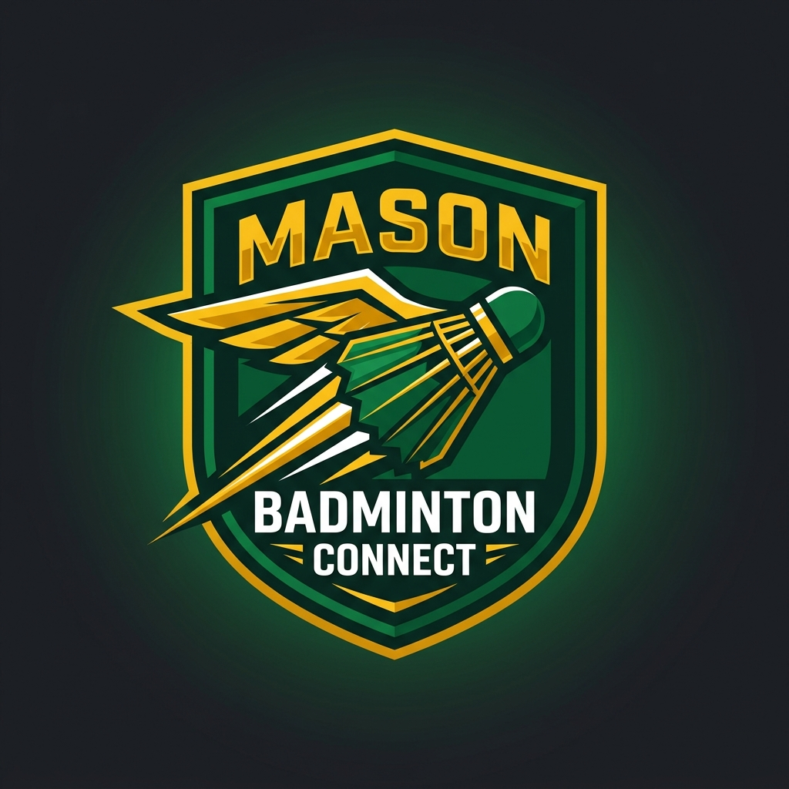

<p align="center">
  
</p>

<h1 align="center">🏸 Mason Badminton Connect</h1>

<p align="center">
  <b>The modern, collegiate sports & community hub for George Mason University badminton players.</b><br>
  Connect with doubles partners, compete on the Glicko-2 leaderboard, schedule RAC gym courts, track live BWF matches with an offline-first umpire pad, and discover regional DMV tournaments powered by AI.
</p>

<p align="center">
  <a href="https://gmu-badminton-openplayschedule.onrender.com"></a>
  <a href="https://gmu-frontend-staging.onrender.com"></a>
  
  
</p>

---

## 🌐 Live Deployments & Branch Environments

Explore the application across our staging and production deployment tiers:

| Environment | Branch | Live URL | Description & Purpose |
| :--- | :--- | :--- | :--- |
| **Production** | [`main`](https://github.com/SuperHuyGaming/GMU-Badminton-App/tree/main) | [**OpenPlaySchedule Production**](https://gmu-badminton-openplayschedule.onrender.com)<br>*(Alternate: [gmu-badminton.onrender.com](https://gmu-badminton.onrender.com))* | **Stable Production Release Branch:** Houses audited, battle-tested releases. Backed by verified database migrations, frozen dependencies, and strict CI/CD gate passes for collegiate club operations. |
| **Staging** | [`develop`](https://github.com/SuperHuyGaming/GMU-Badminton-App/tree/develop) | [**Frontend Staging Preview**](https://gmu-frontend-staging.onrender.com) | **Active Development & Integration Branch:** Bleeding-edge feature branch where all pull requests and Project Titan milestones are integrated, tested with synthetic user bot harnesses, and previewed before production promotion. |

---

## 🌿 Branch Descriptions & Workflow

### 🚀 `main` Branch (Production)
- **Role:** The official production release branch.
- **Stability:** High / Production-grade. Every commit is tagged and vetted against end-to-end regression suites.
- **Deployment:** Automatically deployed to Render at [https://gmu-badminton-openplayschedule.onrender.com](https://gmu-badminton-openplayschedule.onrender.com).
- **Merge Policy:** Fast-forward or squash merge only from `develop` following comprehensive milestone sign-offs.

### 🧪 `develop` Branch (Staging & Integration)
- **Role:** Default branch for day-to-day active engineering and integration of feature branches.
- **Stability:** Pre-release / Staging. Incorporates the latest sprint features (e.g., Project Titan Milestones 1–4, autonomous scraping algorithms, Glicko-2 rating engine).
- **Deployment:** Automatically deployed to Render Staging at [https://gmu-frontend-staging.onrender.com](https://gmu-frontend-staging.onrender.com).
- **Merge Policy:** Accepts PRs from feature branches (`feature/*`, `fix/*`, `chore/*`) with passing CI test suites.

---

## 🛠️ Tools, Libraries & Frameworks by Service

This monorepo is engineered with a modular, service-oriented architecture designed to scale seamlessly:

### 1. 💻 Frontend Web Client (`/client`)
*Modern, responsive, mobile-first PWA with deep forest green OLED dark theme and gold accents.*

- **Core Framework & Build Tool:** [React 19](https://react.dev/), [Vite 8](https://vitejs.dev/)
- **UI & Component System:** [Material-UI (MUI v6/v7)](https://mui.com/) with Emotion styling, [Tailwind CSS](https://tailwindcss.com/)
- **Motion & Gestures:** [Framer Motion](https://www.framer.com/motion/) (touch swipe-to-action gestures, page transitions, fluid dialog modals)
- **State & Data Synchronization:** [TanStack React Query v5](https://tanstack.com/query/latest) (optimistic caching, background invalidation), React Context API
- **Real-Time Client:** [Socket.io-client](https://socket.io/) (chat typing indicators, unread badges, court queue listeners, live bracket progress)
- **PWA & Offline Resilience:** `vite-plugin-pwa`, Service Workers, IndexedDB local score ledger with automatic online replay
- **Virtualization & Performance:** `react-window` for high-frequency directory list virtualization, decoupled lazy flyer image loader
- **Icons & Visuals:** `lucide-react`, `@mui/icons-material`, `canvas-confetti`
- **Testing & Quality Assurance:** [Vitest](https://vitest.dev/), React Testing Library, [Playwright](https://playwright.dev/) (end-to-end multi-browser test harness & synthetic collegiate bot simulations)
- **Accessibility:** WCAG 2.1 AA certified with universal `:focus-visible` rings, high-contrast text ratios ($\ge 4.5:1$), and `aria-live` region announcements

### 2. ⚡ Core API Server (`/server`)
*High-throughput Node.js microservice handling user sessions, court matchmaking, rules engines, and real-time feeds.*

- **Runtime & Web Framework:** [Node.js](https://nodejs.org/) (ES Modules), [Express.js](https://expressjs.com/)
- **Database & Object Modeling:** [MongoDB](https://www.mongodb.com/), [Mongoose](https://mongoosejs.com/) (atomic transactions, Optimistic Concurrency Control with document versioning `__v`)
- **In-Memory Cache & Key-Value Store:** [Redis](https://redis.io/) / [ioredis](https://github.com/redis/ioredis) (atomic tagged cache eviction via `SADD` / non-blocking $O(1)$ `UNLINK` pipelines, token-bucket rate limiting)
- **Real-Time WebSockets:** [Socket.io](https://socket.io/) (room multiplexing, connection recovery, heartbeats)
- **Competitive Sports Engines:**
  - **BWF Rules Engine:** Official 21-point rally scoring, 2-point clear deuce, 30-point golden cap, interval timers (60s/120s), and Game 3 side change at 11 points.
  - **Glicko-2 & Elo Rating Systems:** Two-sided Bayesian skill progression tracking Rating ($R$), Rating Deviation ($RD$), and Volatility ($\sigma$) with inactivity decay.
  - **RAC Court Deadlock & Scheduler:** RAC Gymnasium Courts 1–6 automated court rotation, dynamic match duration estimation, and 10-minute walkover forfeit timers.
- **Security & Integrity:** [JSON Web Tokens (JWT)](https://jwt.io/), [bcrypt](https://github.com/kelektiv/node.bcrypt.js), [express-mongo-sanitize](https://github.com/fiznool/express-mongo-sanitize), CORS security hardening with GMU domain whitelist, 3-strike anti-spam quarantine trigger
- **Media Processing & Storage:** [Cloudinary SDK](https://cloudinary.com/) (flyer compression, responsive image optimization, avatars)
- **Testing Suite:** [Jest](https://jestjs.io/), [Supertest](https://github.com/ladjs/supertest) (comprehensive unit, integration, memory leak, and adversarial stress tests)

### 3. 🔍 Search Microservice (`/search-service`)
*High-speed global search and discovery microservice.*

- **Runtime:** Node.js, Express
- **Search Engine:** [Elasticsearch](https://www.elastic.co/elasticsearch) (fuzzy matching, typo tolerance, multi-field faceted filters, university-weighted relevance ranking)
- **Event Streaming:** [Apache Kafka](https://kafka.apache.org/) ([KafkaJS](https://kafka.js.org/)) event consumers for real-time document indexing and change synchronization
- **Caching:** Redis typeahead autocomplete with millisecond response latencies

### 4. 🤖 Autonomous Scraper & Ingestion Pipeline (`/tournament-services/scraper-service`)
*AI-driven web and social media scraper gathering upcoming DMV tournaments.*

- **Language & Runtime:** [Python 3.12+](https://www.python.org/)
- **AI & NLP Extraction Cascade:** Google Gemini 3.8 Flash & OpenAI GPT-4o multi-model cascade with zero-quota pre-filtering and schema validation
- **Web Crawling:** [Beautiful Soup 4](https://www.crummy.com/software/BeautifulSoup/), Requests (crawling regional collegiate club sites, TournamentSoftware, and Google Forms)
- **Social Media Scraper:** [Instaloader](https://instaloader.github.io/) (Instagram tournament flyers, captions, Linktree bio link resolution)
- **Deduplication Engine:** Hybrid ensemble utilizing Jaro-Winkler (>0.85 threshold), Levenshtein string distance, and TF-IDF Cosine similarity over a 48-hour temporal window
- **Queue & Streaming:** Kafka event producer for streaming discovered tournaments directly into the validation queue
- **Testing:** [pytest](https://docs.pytest.org/) with automated ingestion and deduplication stress suites

### 5. ☕ Tournament Core Service (`/tournament-services/core-service`)
*Enterprise tournament orchestration backend.*

- **Language & Framework:** Java 21, [Spring Boot 3](https://spring.io/projects/spring-boot)
- **Persistence & API:** Spring Data JPA, RESTful endpoints, Maven build system

### 6. 🚢 DevOps, Cloud Infrastructure & CI/CD
*Production-ready infrastructure with automated pipelines.*

- **Containerization:** [Docker](https://www.docker.com/), Docker Compose (orchestrating the full 7-service multi-container architecture locally)
- **Cloud Hosting:** [Render](https://render.com/) (automated staging & production builds with custom domain SSL)
- **CI/CD Automation:** [GitHub Actions](https://github.com/features/actions) (continuous integration, Playwright headless test runs, ESLint code formatting, security audits)
- **Reverse Proxy & Web Server:** Nginx (static asset compression, caching headers, proxy routing)

---

## ✨ Key Platform Features

- **🏆 AI-Powered Tournament Radar:** Autonomously scans DMV regional club sites and Instagram, parses entry forms, deduplicates entries, and notifies players with live calendar export.
- **🏸 RAC Court Live Queue:** Live status for Courts 1–6 at the George Mason Recreation Athletic Complex (RAC), automated walkover timers, and digital queue reservations.
- **📱 Offline-First Umpire Digital Pad:** BWF-certified scorekeeping pad with voice calls, interval countdowns, and IndexedDB ledger with offline score synchronization.
- **📈 Glicko-2 & Elo Skill Progression:** Accurate singles and doubles matchmaking with dynamic volatility adjustments, inactivity decay, and glowing top-3 leaderboard badges.
- **💬 Community Hub & Real-Time Chat:** WebSocket-powered discussion boards, reaction emojis, media lightboxes, spam quarantine, and direct player messaging.
- **🔍 Facebook-Caliber Global Search:** Instantaneous typeahead search across players, tournaments, and community discussions powered by Elasticsearch and Redis.

---

## 🚀 Getting Started Locally

### Prerequisites
- [Docker Desktop](https://www.docker.com/products/docker-desktop/) installed and running.
- [Node.js](https://nodejs.org/) (v20+ recommended) and `npm`.

### 1. Clone the Repository
```bash
git clone https://github.com/SuperHuyGaming/GMU-Badminton-App.git
cd GMU-Badminton-App
```

### 2. Launch the Full Stack via Docker
Run the following command to spin up MongoDB, Redis, Kafka, Elasticsearch, Express API, Search Service, Scraper Worker, and the React UI:
```bash
docker compose up --build -d
```

### 3. Frontend Development (Instant Hot-Reload)
For rapid frontend iteration with Vite hot module replacement:
```bash
cd client
npm install --legacy-peer-deps
npm run dev
```
Open [http://localhost:5173](http://localhost:5173) in your browser.

---

## 🏆 Project Creator & Maintainer

<table>
  <tbody>
    <tr>
      <td align="center" valign="top">
        <a href="https://github.com/SuperHuyGaming">
          
          <br />
          <sub><b>Huy Truong (SuperHuyGaming)</b></sub>
        </a>
        <br />
        <sub>Lead Architect, Creator & Full-Stack Engineer</sub>
        <br />
        <a href="https://github.com/SuperHuyGaming/GMU-Badminton-App/commits?author=SuperHuyGaming" title="Code">💻</a>
        <a href="#design" title="UI/UX Design">🎨</a>
        <a href="#architecture" title="Architecture">🏗️</a>
        <a href="#maintenance" title="Maintenance">🚧</a>
        <a href="#infra" title="DevOps & Cloud">☁️</a>
      </td>
    </tr>
  </tbody>
</table>

---

## 📝 License
This project is licensed under the **MIT License** - see the [LICENSE](LICENSE) file for details.
